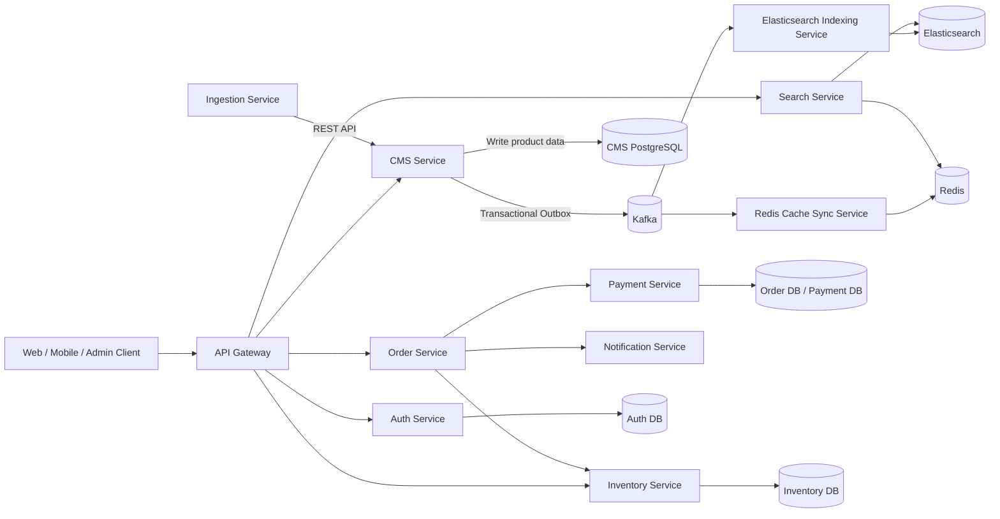
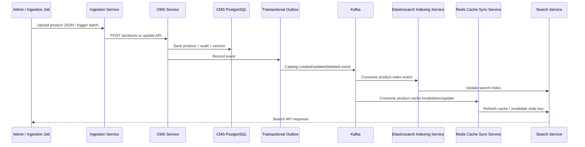
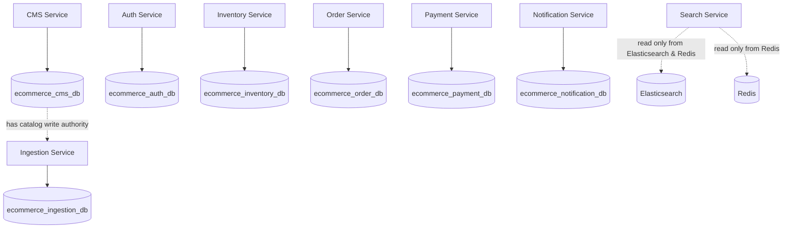
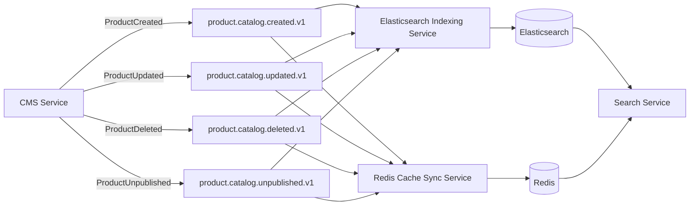

# Mermaid Architecture Diagrams

## 1. Platform architecture overview

## 2. Catalog ownership and event propagation diagram

## 3. Database ownership map

## 4. Kafka event flow for product catalog synchronization

